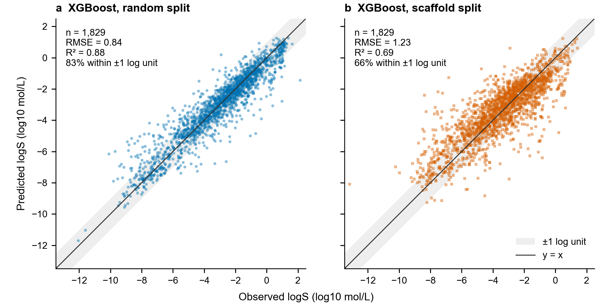
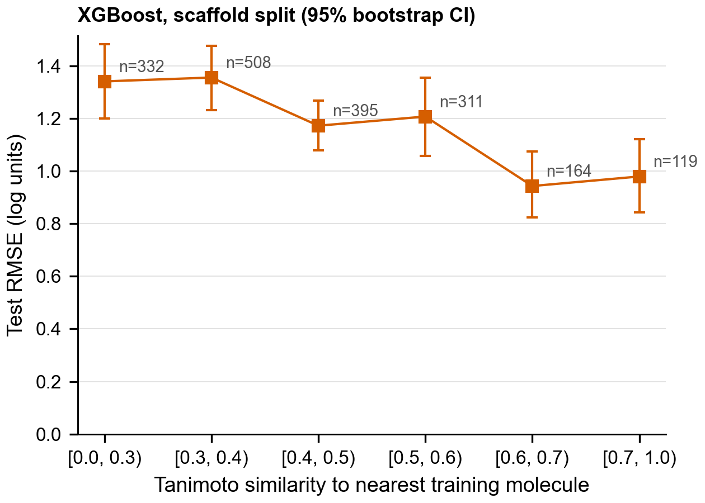
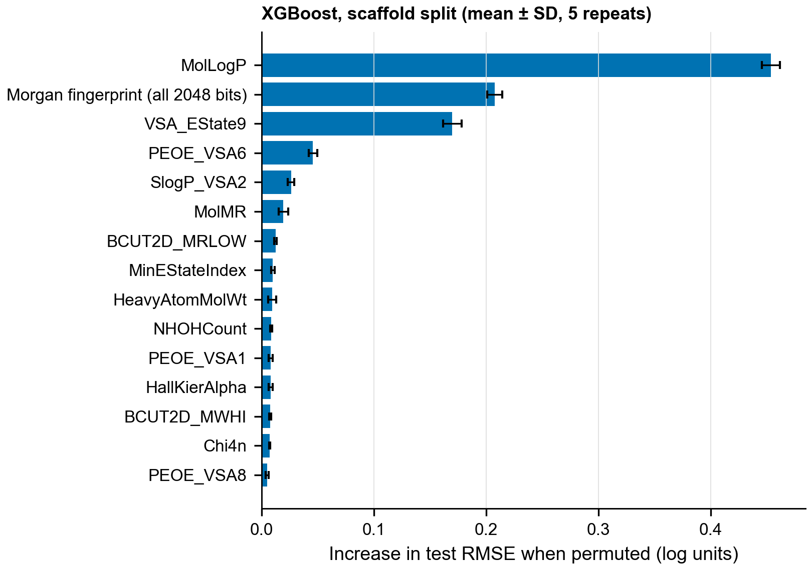

# Project 03: Aqueous solubility prediction under scaffold shift

## Question

How well can machine learning predict aqueous solubility (logS) for molecules whose
chemical series the model has never seen? Most published benchmarks split data at
random, so near-identical analogues end up in both training and test. In a discovery
project the useful prediction is for a new chemotype. This project measures how much
of the reported accuracy survives that shift.

## Why it matters

Poor solubility limits oral absorption and causes failures in assays and formulation.
A solubility model is only useful for triage if its error is known for the chemistry it
will be applied to. A model that looks accurate on a random split can still be wrong by
more than a log unit on a new scaffold, and a project team needs to know that before
using it to rank compounds.

## Data

- **Source:** AqSolDB (Sorkun, Khetan and Er, *Sci Data* 2019, 6:143,
  [doi:10.1038/s41597-019-0151-1](https://doi.org/10.1038/s41597-019-0151-1)),
  Harvard Dataverse [doi:10.7910/DVN/OVHAW8](https://doi.org/10.7910/DVN/OVHAW8),
  version 1, CC0 1.0
- **Size:** 9,982 compounds with experimental logS (log10 mol/L), merged from several public datasets
- **Download date:** 2026-10-16, checked against the Dataverse MD5
- **Noise floor:** 2,236 compounds were measured by more than one source. Their
  between-source SD has a median of 0.13 and an RMS of 0.52 log units. No model can be
  expected to beat the second figure by much on this data.

## Methods

1. **Curation** (`analysis/02_curate_featurize.py`)
   - RDKit standardisation: cleanup, largest organic fragment (removes counter-ions),
     charge neutralisation.
   - Organic molecules only. 519 records were removed as inorganic or metal complexes.
     Metals are checked on the original record, because RDKit stores some complexes
     (for example copper phthalocyanines) with the metal as a separate fragment that
     fragment selection would silently drop.
   - Stripping salts made 166 groups of records collapse to the same parent molecule.
     82 of these disagreed by more than 1 log unit (salt and free form differ in
     solubility) and were dropped. The rest were averaged.
   - Final set: **9,145 molecules**, 1,854 Bemis-Murcko scaffolds, 2,326 acyclic.
2. **Features:** 217 RDKit 2D descriptors (Ipc on a log10 scale, since it reaches
   1e54), Morgan count fingerprints (radius 2, 2,048 bits), and the four ESOL inputs.
3. **Splits** (80/20, made before any preprocessing):
   - *Random:* 316 of the 575 test scaffolds also occur in training.
   - *Scaffold:* Bemis-Murcko groups, largest first into training
     ([Bemis and Murcko 1996](https://doi.org/10.1021/jm9602928)). None of the 1,542
     test scaffolds occur in training.
4. **Models** (`analysis/03_train_evaluate.py`)
   - Training mean, as the floor.
   - ESOL: the linear form of [Delaney 2004](https://doi.org/10.1021/ci034243x) (cLogP,
     MW, rotatable bonds, aromatic proportion), refit on the training set.
   - Random forest (500 trees, max_features 0.3, settings fixed in advance).
   - XGBoost. Depth and min_child_weight were tuned by 5-fold CV inside the training
     set, grouped by scaffold for the scaffold split.
   - Missing descriptor values (84 cells) were imputed with the training median inside
     each pipeline.
5. **Evaluation:** RMSE, MAE and R² on the held-out test set, with 95% bootstrap CIs
   (2,000 resamples). Further analyses: error by Tanimoto similarity to the nearest
   training molecule, and permutation importance with the fingerprint permuted as one
   block.

## Results

| Model | Random split RMSE [95% CI] | Random R² | Scaffold split RMSE [95% CI] | Scaffold R² |
|---|---|---|---|---|
| Training mean | 2.42 [2.34, 2.50] | 0.00 | 2.31 [2.24, 2.39] | −0.10 |
| ESOL (refit) | 1.55 [1.46, 1.65] | 0.59 | 2.30 [2.15, 2.46] | −0.09 |
| Random forest | 0.90 [0.85, 0.95] | 0.86 | 1.27 [1.21, 1.32] | 0.67 |
| **XGBoost** | **0.85 [0.80, 0.89]** | **0.88** | **1.23 [1.18, 1.29]** | **0.69** |

Test n = 1,829 in both splits. All metrics are in log10 mol/L. Full table:
`results/metrics.csv`.


*Figure 1. Test RMSE and R² for each model and split. Points are estimates; bars are
95% bootstrap CIs. The dashed line is the RMS between-source SD (0.52), an empirical
noise floor.*

- **Scaffold shift costs about 0.4 log units.** XGBoost RMSE rises from 0.85 to 1.23
  and R² falls from 0.88 to 0.69. The CIs do not overlap. 83% of random-split
  predictions fall within ±1 log unit of the measured value, against 66% on new
  scaffolds.
- **The scaffold test set is chemically harder, not only new.** Its molecules are
  larger and more lipophilic (median MW 301 vs 212 in training; median cLogP 2.78 vs
  2.07) and less soluble (median logS −3.29 vs −2.47). See `results/split_shift.csv`.
- **ESOL fails under the shift.** It drops to the level of predicting the mean.
  Because it is linear, it extrapolates badly on molecules outside the training range:
  it predicts logS −24 for a 2,286 Da molecule measured at −5.4. Removing its 10 worst
  errors still leaves RMSE at 2.13, so the failure is broad, not a few outliers.
- **Tree models compress the extremes.** On the scaffold split, compounds with
  measured logS below −6 (n = 251) are overpredicted by 1.16 log units on average,
  against 0.60 on the random split. The model is least reliable for the poorly soluble
  compounds a project most needs to flag.


*Figure 2. Predicted against observed logS for XGBoost. The grey band marks ±1 log
unit.*

- **Error falls with similarity to the training set.** Test RMSE is 1.34 for
  molecules whose nearest training neighbour has Tanimoto < 0.3, and 0.94 to 0.98 above
  0.6.


*Figure 3. Scaffold-split RMSE by Tanimoto similarity (Morgan, radius 2, 2,048 bits)
to the nearest training molecule. Bars are 95% bootstrap CIs; n per bin is shown.*

- **Lipophilicity dominates.** Permuting MolLogP raises the test RMSE by 0.45 log
  units, more than the whole fingerprint block (0.21). VSA_EState9 comes third (0.17).


*Figure 4. Increase in scaffold-split test RMSE when each feature is permuted (mean ±
SD over 5 repeats). The 2,048 fingerprint bits are permuted together.*

## Interpretation

The random-split numbers overstate how the model would perform on a new series. The honest estimate for a new
chemotype is about 1.2 log units RMSE, roughly a 16-fold error in concentration, and
worse when the nearest known analogue is distant.

The dominance of cLogP fits the physical picture of solubility: hydrophobicity drives
it, and crystal packing (which 2D descriptors cannot see) accounts for much of the rest.
That missing solid-state information is a plausible reason for the remaining error,
together with the measurement noise.

## Decision

- Use the model for ranking and triage within a series, not as a replacement for
  measurement.
- Report the nearest-neighbour similarity next to each prediction. Below Tanimoto ~0.5
  the expected error is above 1.2 log units, so such compounds should be measured.
- Treat predictions below logS −6 as optimistic. The true value is likely lower.
- Do not use a linear ESOL-type model outside the size and lipophilicity range it was
  fitted on.

## Limitations

- AqSolDB merges sources that measured solubility under different conditions
  (temperature, pH, solid form). This variability sets a floor on the error any model
  can reach.
- Salts are reduced to the parent molecule. For the 797 records changed by
  standardisation, the measured value refers to a form the features do not describe.
  Conflicting salt and parent pairs were dropped, but single salt records remain.
- 2D descriptors and fingerprints carry no information on crystal form or melting
  point, which strongly affect solubility.
- Bootstrap CIs resample molecules. Molecules that share a scaffold are not
  independent, so the intervals are probably somewhat too narrow; a scaffold-level
  bootstrap would be more conservative.
- One scaffold split with one seed. A repeated or cluster-based split would give the
  variance of the shift itself.
- Permutation importance splits credit between correlated descriptors (several
  surface-area and lipophilicity terms overlap), so the ranking beyond the top few is
  not robust.
- Random forest settings were fixed rather than tuned. XGBoost tuning covered a small
  grid.

## Next steps

- Add a drug-like subset (for example MW 150 to 700) to report performance where
  pharma projects usually operate.
- Calibrate prediction intervals, for example with conformal prediction, so each
  compound gets an error bar instead of a global RMSE.
- Test whether adding melting point (where available) closes part of the gap left by
  the missing solid-state information.
- Extend to a second ADME endpoint (Caco-2 permeability or lipophilicity) with the same
  split protocol.

## How to run

```bash
pip install -r requirements.txt
python analysis/01_fetch_data.py         # download + MD5 check
python analysis/02_curate_featurize.py   # ~1.5 min
python analysis/03_train_evaluate.py     # ~20 min on 8 CPU cores
python analysis/04_figures.py
```

Run all scripts from this folder. Seeds are fixed (`SEED = 42`). Raw and processed data
are not versioned; tables go to `results/` and figures to `figures/`. Package versions
for the reported run are pinned in `requirements.txt`.
