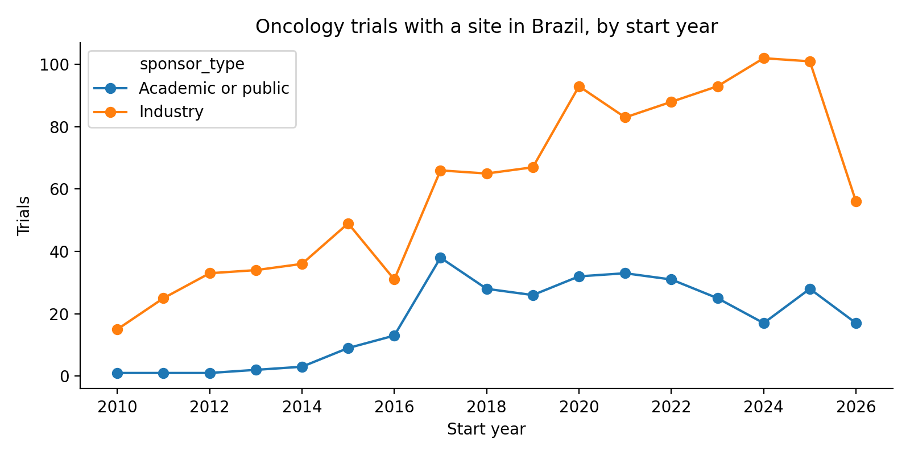
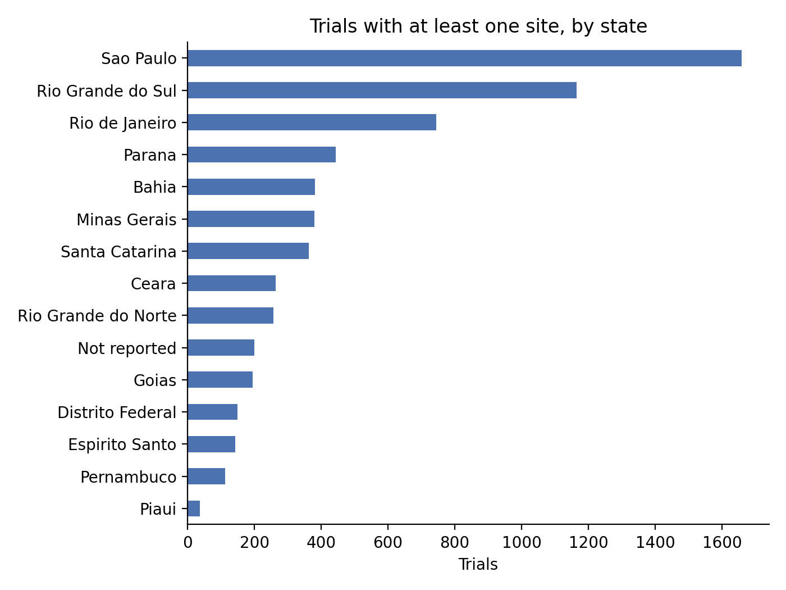

# Project 04: Oncology clinical trials with sites in Brazil

## Question

Which oncology trials run in Brazil, who sponsors them, in which phases and
tumour types, and where are the sites? This is the kind of picture a CRO or a
sponsor's clinical operations team builds before a feasibility assessment.

## Data

- Source: [ClinicalTrials.gov API v2](https://clinicaltrials.gov/data-api/api)
- Filter: interventional studies, at least one site in Brazil, conditions
  matching common cancer terms (see `PARAMS` in `analysis/01_fetch_trials.py`)
- Download date: 2026-10-16

## Methods

1. `analysis/01_fetch_trials.py` pages through the API and saves one row per
   trial and one row per Brazilian site.
2. `analysis/02_analyze.py` groups trials by start year, sponsor type
   (industry vs academic or public), phase, tumour type and state, and counts
   how many trials are multinational.

Tumour type comes from a keyword match on the listed conditions. The first
matching term in `TUMOUR_TERMS` wins, so a trial listing several tumours is
counted once, under the first one in that list. Trials whose conditions match
none of the terms (generic terms such as "solid tumors", or rarer cancers) fall
into "Other or mixed".

## Results

Snapshot of 2026-10-16. Rerunning the fetch will give slightly different numbers.

| Metric | Value |
|---|---|
| Trials | 1,908 |
| Brazilian sites | 11,387 |
| Median Brazilian sites per trial | 5 |
| Industry-sponsored | 72.0% |
| Multinational | 73.4% |
| Recruiting now | 325 |

- **Phase:** Phase 3 dominates (1,020 trials, 53%), followed by Phase 2 (388). Early-phase work
  is rare: 52 Phase 1 and 92 Phase 1/2 trials.
- **Tumour type:** breast (313) and lung (299) lead, then gynaecological (117), lymphoma (115)
  and prostate (112). 352 trials match no tumour-specific term.
- **Sponsors:** Roche (173), AstraZeneca (140), MSD (109), Novartis (109) and BMS (91) are the
  largest lead sponsors. Counts are per registered legal entity, so subsidiaries appear
  separately (for example Genentech, 13, is not added to Roche; Celgene, 13, is not added
  to BMS).
- **Geography:** São Paulo has sites in 1,658 trials, Rio Grande do Sul in 1,165 and Rio de
  Janeiro in 745. The North is thinly covered (Pará 34, Rondônia 12, Amazonas 4,
  Roraima 4). In the Centre-West, activity concentrates in Goiás (194) and the Federal
  District (149); Mato Grosso and Mato Grosso do Sul have 2 and 5. 199 trials have a
  Brazilian site whose state could not be identified.
- **Trend:** industry-sponsored starts rose from 15 in 2010 to about 100 per year in
  2024-2025. Academic or public starts were below 15 per year until 2016 and have stayed
  between 17 and 38 per year since 2017. The 2026 values cover only part of the year.




## Limitations

- ClinicalTrials.gov is not the only registry. Trials registered only in
  ReBEC (the Brazilian registry) are missing.
- Site lists are as reported by sponsors and are not always up to date.
- The keyword match for tumour type is simple and will misclassify some
  trials. The rules are in `TUMOUR_TERMS` and easy to check.
- State names are reported inconsistently (accents, abbreviations, typos, city
  names in the state field). They are normalised in `clean_state`, which falls
  back to the city when the state is empty; anything it still cannot match is
  counted as "Not reported".
- The condition query uses free-text cancer terms, so a few trials about
  supportive care in cancer patients may be included.

## How to run

```bash
pip install -r requirements.txt
python analysis/01_fetch_trials.py
python analysis/02_analyze.py
```

Run both scripts from this folder. Raw and processed data are not versioned;
tables go to `results/` and figures to `figures/`.
