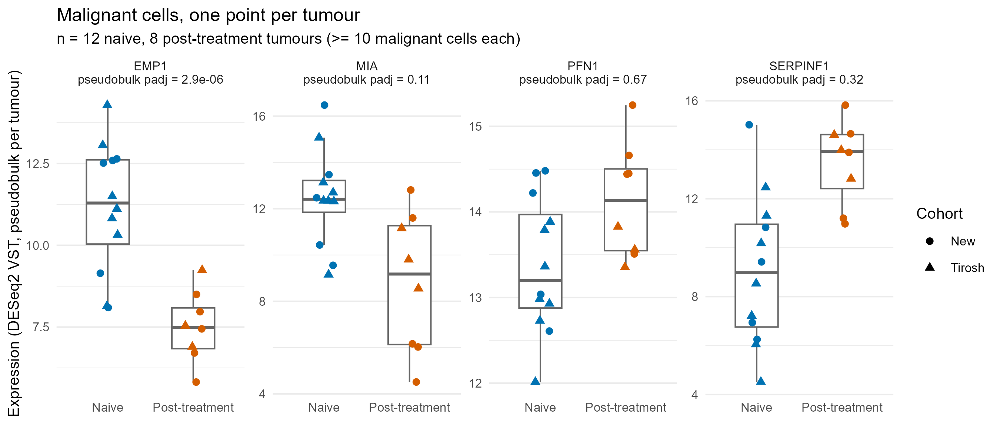
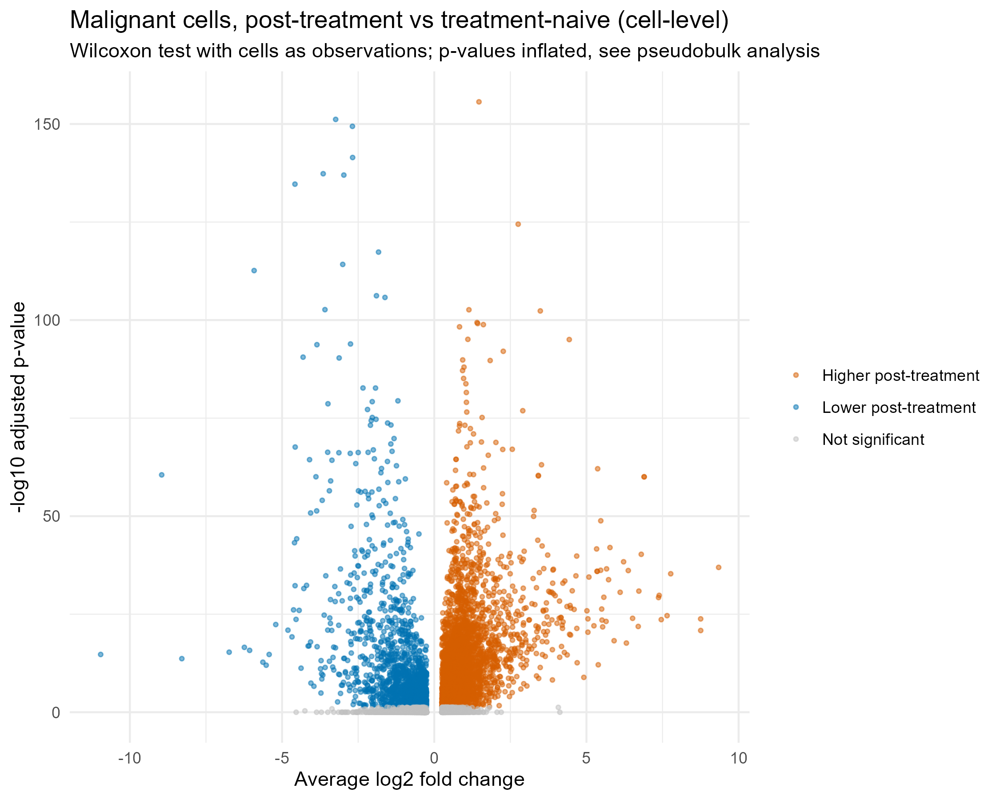

# Malignant-cell changes after immunotherapy in melanoma, at the tumour level

Melanoma biopsies taken after immune checkpoint therapy can be compared with untreated ones
to look for transcriptional programs in the malignant cells that relate to resistance and to
T-cell exclusion. This project makes that comparison in a public single-cell dataset and
checks which differences survive when tumours, not cells, are treated as the replicates.

## Data

GSE115978 ([GEO](https://www.ncbi.nlm.nih.gov/geo/query/acc.cgi?acc=GSE115978)), from
Jerby-Arnon et al., "A cancer cell program promotes T cell exclusion and resistance to
checkpoint blockade", *Cell* 2018, 175:984-997
([doi:10.1016/j.cell.2018.09.006](https://doi.org/10.1016/j.cell.2018.09.006)).

Smart-seq2 profiles of 7,186 cells from 31 melanoma tumours, combining the earlier Tirosh
cohort with new samples. The cell annotation file gives the sample, the published cell type,
the cohort and whether the biopsy was taken before treatment (`treatment.naive`) or after
(`post.treatment`). It has no clinical response labels, so the analysis compares biopsy
timing, not responders with non-responders.

## Methods

1. `02_qc.R`: genes detected, total counts and mitochondrial fraction per cell (thresholds
   500 genes, 1,000 counts, 20% mitochondrial). All 7,186 cells pass, as the deposited data
   were already filtered by the authors.
2. `03_seurat_preprocessing.R`: LogNormalize, 2,000 variable genes, PCA.
3. `04_clustering_annotation.R`: Louvain clustering (resolution 0.8, 30 PCs) and UMAP,
   compared with the published cell types.
4. `05_resistance_program_analysis.R`: in malignant cells, a cell-level Wilcoxon test
   between post-treatment and treatment-naive biopsies, and a per-sample signature score
   correlated with the fraction of T cells in the same sample. Exploratory.
5. `06_pseudobulk_de.R`: the same comparison with tumours as replicates. Raw counts of the
   malignant cells are summed per sample (20 samples with at least 10 malignant cells: 12
   treatment-naive, 8 post-treatment) and tested with DESeq2, `~ Cohort + treatment.group`,
   so the Tirosh/New batch is accounted for. 15,146 genes pass the expression filter.

## Results

Clustering gives 29 clusters, finer than the 10 published labels (9 cell types plus "?" for unassigned cells)
(`data/processed/cluster_vs_celltype_crosstab.csv` after running the pipeline).

At the cell level, 5,384 genes differ between post-treatment and treatment-naive malignant
cells (adjusted p < 0.05, |log2FC| > 0.25). Among the strongest are MIA (log2FC −3.65),
EMP1 (−4.58), SERPINF1 (+2.76) and PFN1 (+1.47).

These p-values treat every cell as an independent observation, although treatment was given
to tumours and malignant cells in melanoma group strongly by patient. With tumours as
replicates, 117 genes reach adjusted p < 0.05, and only 61 of the 5,384 cell-level hits
(1.1%) are among them (`results/cell_vs_pseudobulk_comparison.csv`).

| Gene | Cell-level log2FC | Pseudobulk log2FC | Pseudobulk adjusted p |
|---|---|---|---|
| EMP1 | −4.58 | −4.51 | 2.9 × 10⁻⁶ |
| MIA | −3.65 | −3.25 | 0.11 |
| SERPINF1 | +2.76 | +2.52 | 0.32 |
| PFN1 | +1.47 | +0.51 | 0.67 |


*Expression of the four genes per tumour (DESeq2 variance-stabilised pseudobulk). Each point
is one tumour; shape marks the cohort.*

The signature score built from the 50 genes most increased in the cell-level test does not
correlate with the T-cell fraction of the sample (Spearman rho = −0.15, p = 0.50, n = 23
samples with malignant cells).


*Cell-level test in malignant cells. The p-values are inflated by pseudoreplication and are
shown for comparison with the pseudobulk result.*

## Interpretation

Of the four genes the cell-level analysis put forward, only the decrease of EMP1 after
treatment holds when tumours are the replicates. MIA, a melanocytic differentiation marker,
and SERPINF1 change in the same direction on average but do not pass correction with
8 and 12 tumours per group; PFN1 barely changes. The cell-level test mostly measured
differences between patients.

The data do not support a link between the signature score and T-cell infiltration. The
score was built from cell-level genes, and with 23 samples the test has little power, so
this is a null result rather than evidence of no effect.

## Decision

EMP1 is the candidate worth following up, for example by checking its expression against
treatment and T-cell infiltration in an independent bulk cohort. MIA and SERPINF1 stay as
secondary hypotheses. Nothing here is strong enough to prioritise a target.

## Limitations

- Biopsy timing is a proxy. There are no response labels, and each sample is a separate
  tumour, so differences between patients are mixed with the effect of treatment.
- The T-cell fraction is the share of T cells among the cells sequenced, not among the
  cells in the tumour. Cells were sorted into CD45+ and CD45− plates before sequencing
  (Tirosh et al. 2016; Jerby-Arnon et al. 2018), so the fraction partly reflects how many
  cells of each compartment were profiled. Infiltration is better measured in bulk data by
  deconvolution or by immunohistochemistry.
- 20 tumours enter the pseudobulk test, so power is low and some real effects will be missed.
- Genes with very large pseudobulk fold changes (for example MAGEA4, log2FC 13.5) can be
  driven by one or two tumours with extreme expression; check them per sample before use.
- The signature score in step 4 uses genes from the cell-level test. Rebuilding it from the
  pseudobulk genes is a next step.
- Smart-seq2 without UMIs: LogNormalize is an approximation for full-length data.

## Next steps

- Rebuild the signature score from the pseudobulk genes and test it again.
- Check EMP1, MIA and SERPINF1 in an independent bulk RNA-seq cohort with response data,
  and test the signature against deconvolved T-cell infiltration there.

## How to run

```bash
Rscript analysis/01_download_gse115978.R   # downloads ~300 MB from GEO
Rscript analysis/02_qc.R
Rscript analysis/03_seurat_preprocessing.R
Rscript analysis/04_clustering_annotation.R
Rscript analysis/05_resistance_program_analysis.R
Rscript analysis/06_pseudobulk_de.R
```

Run from the repository root (paths use `here`). Seeds are fixed. The full pipeline was rerun
on 2026-10-16 with R 4.5.2 and reproduced every number above; package versions are in
`requirements.txt` and `results/sessionInfo_06.txt`. Raw and processed data are not
versioned.
