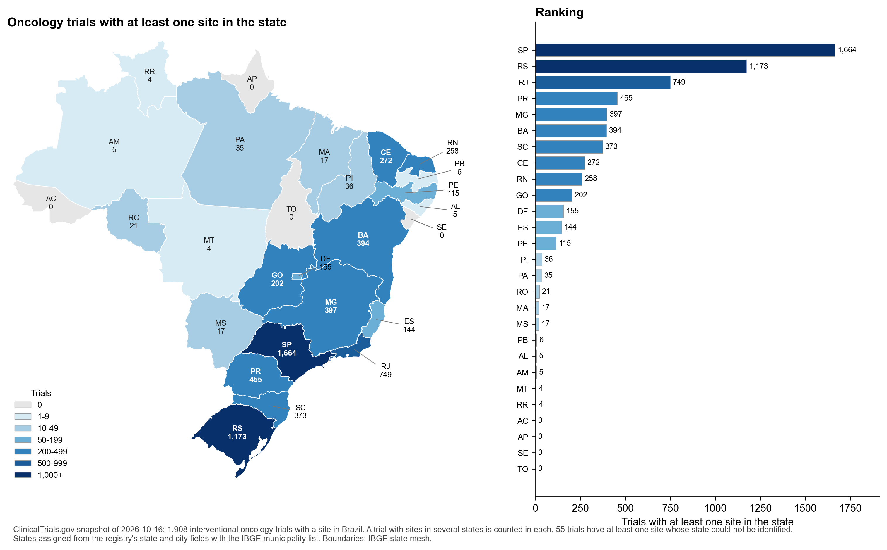
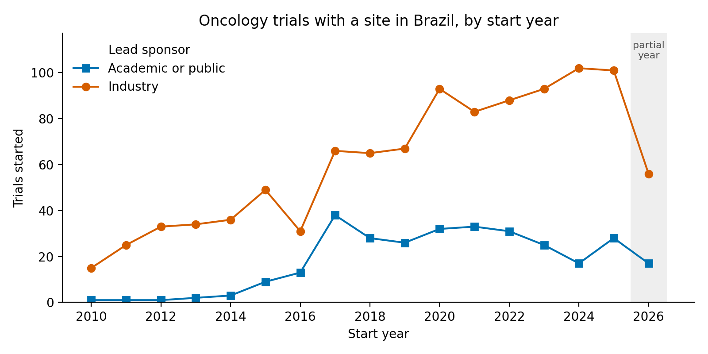

# Oncology clinical trials with sites in Brazil

## Question

Which oncology trials run in Brazil, who sponsors them, in which phases and
tumour types, and where are the sites? This is the kind of picture a CRO or a
sponsor's clinical operations team builds before a feasibility assessment.

## Data

- Source: [ClinicalTrials.gov API v2](https://clinicaltrials.gov/data-api/api)
- Filter: interventional studies, at least one site in Brazil, conditions
  matching common cancer terms (see `PARAMS` in `analysis/01_fetch_trials.py`)
- Download date: 2026-10-16

## Methods

1. `analysis/01_fetch_trials.py` pages through the API and saves one row per
   trial and one row per Brazilian site.
2. `analysis/02_analyze.py` groups trials by start year, sponsor type
   (industry vs academic or public), phase, tumour type and state, and counts
   how many trials are multinational.
3. `analysis/03_map.py` draws the map of trials per state and summarises them by
   region, using the IBGE state mesh and list of states.

Each Brazilian site is assigned to a state from the registry's state field or, when
that is empty or unclear, from the city field. City names are matched against the IBGE
list of 5,570 municipalities and accepted only when the name exists in a single state;
state capitals and a few common spellings are fixed by hand, and forms such as
"Porto Alegre - RS" or "Salvador, Bahia" are read directly.

Tumour type comes from a keyword match on the listed conditions. The first
matching term in `TUMOUR_TERMS` wins, so a trial listing several tumours is
counted once, under the first one in that list. Trials whose conditions match
none of the terms (generic terms such as "solid tumors", or rarer cancers) fall
into "Other or mixed".

## Results

Snapshot of 2026-10-16. Rerunning the fetch will give slightly different numbers.

| Metric | Value |
|---|---|
| Trials | 1,908 |
| Brazilian sites | 11,387 |
| Median Brazilian sites per trial | 5 |
| Industry-sponsored | 72.0% |
| Multinational | 73.4% |
| Recruiting now | 325 |

Phase 3 trials make up more than half of the total (1,020, 53%), followed by Phase 2 (388).
Early-phase work is rare: 52 Phase 1 and 92 Phase 1/2 trials. Breast (313) and lung (299)
are the most frequent tumour types, then gynaecological cancers (117), lymphoma (115) and
prostate (112); 352 trials match no tumour-specific term.

The largest lead sponsors are Roche (173), AstraZeneca (140), MSD (109), Novartis (109) and
BMS (91). Counts are per registered legal entity, so subsidiaries appear separately:
Genentech (13) is not added to Roche, nor Celgene (13) to BMS.

São Paulo has sites in 1,664 trials (87%), Rio Grande do Sul in 1,173 and Rio de Janeiro in
749. The North has few (Pará 35, Rondônia 21, Amazonas 5, Roraima 4), and Acre, Amapá,
Sergipe and Tocantins have none. In the Centre-West, sites are concentrated in Goiás (202)
and the Federal District (155), with 17 trials in Mato Grosso do Sul and 4 in Mato Grosso.
For 55 trials, the state of at least one Brazilian site could not be identified.

| Region | Trials with a site in the region | Share of all trials |
|---|---|---|
| Southeast | 1,771 | 92.8% |
| South | 1,281 | 67.1% |
| Northeast | 750 | 39.3% |
| Centre-West | 336 | 17.6% |
| North | 59 | 3.1% |

A trial with sites in several regions counts in each, so the shares add up to more than
100% (`results/trials_by_region.csv`, `results/trials_by_state_uf.csv`).


*Trials with at least one site in each state, on a colour scale with roughly logarithmic
bins, and the same counts ranked. State boundaries from IBGE.*

Industry-sponsored starts rose from 15 in 2010 to about 100 per year in 2024 and 2025.
Academic or public starts were below 15 per year until 2016 and have stayed between 17 and
38 per year since 2017. The 2026 values cover only part of the year.



## Limitations

- ClinicalTrials.gov is not the only registry. Trials registered only in
  ReBEC (the Brazilian registry) are missing.
- Site lists are as reported by sponsors and are not always up to date.
- The keyword match for tumour type is simple and will misclassify some
  trials. The rules are in `TUMOUR_TERMS` and easy to check.
- State names are reported inconsistently (accents, abbreviations, typos, city
  names in the state field). Sites whose state cannot be recovered without guessing
  (neighbourhood names, cities that exist in more than one state) are counted as
  "Not reported".
- Counts show where trials run, not how many patients they enrol, and are not
  adjusted for population.
- The condition query uses free-text cancer terms, so a few trials about
  supportive care in cancer patients may be included.

## How to run

```bash
pip install -r requirements.txt
python analysis/01_fetch_trials.py
python analysis/02_analyze.py
python analysis/03_map.py
```

Run both scripts from this folder. Raw and processed data are not versioned;
tables go to `results/` and figures to `figures/`.
