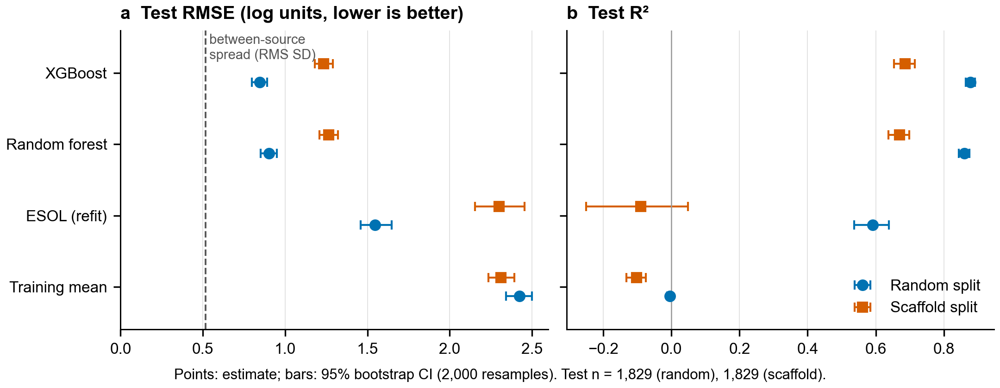

# Aqueous solubility prediction under scaffold shift

How well can a model predict aqueous solubility (logS) for molecules from a chemical
series it has never seen? Most benchmarks split the data at random, so close analogues end
up in both training and test. In a discovery project the prediction that matters is for a
new chemotype, so this analysis measures how much accuracy is left under that shift.

Poor solubility limits oral absorption and causes failures in assays and formulation. A
solubility model is useful for triage only if its error is known for the chemistry it will
be applied to.

## Data

AqSolDB (Sorkun, Khetan and Er, *Sci Data* 2019, 6:143,
[doi:10.1038/s41597-019-0151-1](https://doi.org/10.1038/s41597-019-0151-1)), Harvard
Dataverse [doi:10.7910/DVN/OVHAW8](https://doi.org/10.7910/DVN/OVHAW8), version 1, CC0 1.0.
It holds 9,982 compounds with experimental logS (log10 mol/L) merged from several public
datasets. Downloaded on 2026-10-16 and checked against the Dataverse MD5.

2,236 compounds were measured by more than one source. Their between-source SD has a median
of 0.13 and a root mean square of 0.52 log units, which gives a rough floor for the error
any model can reach on this data.

## Methods

Curation (`analysis/02_curate_featurize.py`). Structures were standardised with RDKit
(cleanup, largest organic fragment to remove counter-ions, charge neutralisation). Only
organic molecules were kept: 519 records were removed as inorganic or metal complexes. Metals
are checked on the original record, because RDKit stores some complexes, such as copper
phthalocyanines, with the metal as a separate fragment that fragment selection would drop
without warning. After standardisation, 166 groups of records became the same parent
molecule. 82 of them disagreed by more than 1 log unit, usually a salt and its free form, and
were dropped; the rest were averaged. The final set has 9,145 molecules, 1,854 Bemis-Murcko
scaffolds and 2,326 acyclic molecules.

Features: 217 RDKit 2D descriptors (Ipc on a log10 scale, since it reaches 1e54), Morgan
count fingerprints (radius 2, 2,048 bits) and the four ESOL inputs.

Splits (80/20, made before any preprocessing). In the random split, 316 of the 575 test
scaffolds also occur in training. In the scaffold split, Bemis-Murcko groups go to training
largest first ([Bemis and Murcko 1996](https://doi.org/10.1021/jm9602928)), and none of the
1,542 test scaffolds occur in training.

Models (`analysis/03_train_evaluate.py`): the training mean as a floor; the linear ESOL form
of [Delaney 2004](https://doi.org/10.1021/ci034243x) (cLogP, MW, rotatable bonds, aromatic
proportion) refit on the training set; a random forest (500 trees, max_features 0.3, fixed
in advance); and XGBoost, with depth and min_child_weight tuned by 5-fold cross-validation
inside the training set, grouped by scaffold for the scaffold split. Missing descriptor
values (84 cells) were imputed with the training median inside each pipeline.

Evaluation: RMSE, MAE and R² on the held-out test set with 95% bootstrap CIs (2,000
resamples), error by Tanimoto similarity to the nearest training molecule, and permutation
importance with the fingerprint permuted as one block.

## Results

| Model | Random split RMSE [95% CI] | Random R² | Scaffold split RMSE [95% CI] | Scaffold R² |
|---|---|---|---|---|
| Training mean | 2.42 [2.34, 2.50] | 0.00 | 2.31 [2.24, 2.39] | −0.10 |
| ESOL (refit) | 1.55 [1.46, 1.65] | 0.59 | 2.30 [2.15, 2.46] | −0.09 |
| Random forest | 0.90 [0.85, 0.95] | 0.86 | 1.27 [1.21, 1.32] | 0.67 |
| XGBoost | 0.85 [0.80, 0.89] | 0.88 | 1.23 [1.18, 1.29] | 0.69 |

Test n = 1,829 in both splits; all errors in log10 mol/L (`results/metrics.csv`).


*Figure 1. Test RMSE and R² for each model and split. Points are estimates and bars 95%
bootstrap CIs. The dashed line is the RMS between-source SD (0.52).*

Moving from the random to the scaffold split raises the XGBoost RMSE from 0.85 to 1.23 and
lowers R² from 0.88 to 0.69, with non-overlapping CIs. Within ±1 log unit of the measured
value fall 83% of random-split predictions and 66% of scaffold-split predictions. Part of
the drop comes from the test molecules themselves: in the scaffold split they are larger,
more lipophilic and less soluble than the training set (median MW 301 vs 212, cLogP 2.78 vs
2.07, logS −3.29 vs −2.47; `results/split_shift.csv`).

ESOL falls to the level of the training mean on the scaffold split. As a linear model it
extrapolates poorly beyond the training range, for example predicting logS −24 for a
2,286 Da molecule measured at −5.4. Its RMSE stays at 2.13 even without its 10 worst errors.

The tree models pull extreme values towards the middle. On the scaffold split, compounds
measured below logS −6 (n = 251) are overpredicted by 1.16 log units on average, against 0.60
on the random split, so the poorly soluble compounds are the ones predicted worst.


*Figure 2. Predicted against observed logS for XGBoost. The grey band marks ±1 log unit.*

Error decreases as similarity to the training set increases: RMSE is 1.34 and 1.36 for
molecules whose nearest training neighbour has Tanimoto below 0.3 and 0.3 to 0.4, and 0.94
to 0.98 above 0.6.


*Figure 3. Scaffold-split RMSE by Tanimoto similarity (Morgan, radius 2, 2,048 bits) to the
nearest training molecule. Bars are 95% bootstrap CIs; n per bin is shown.*

Permuting MolLogP raises the scaffold-split RMSE by 0.45 log units, more than permuting the
whole fingerprint block (0.21); VSA_EState9 comes next (0.17).


*Figure 4. Increase in scaffold-split test RMSE when each feature is permuted (mean ± SD over
5 repeats). The 2,048 fingerprint bits are permuted together.*

## Interpretation

For a new chemotype the realistic error is about 1.2 log units RMSE, roughly a 17-fold error
in concentration, and larger when the nearest known analogue is distant. The random split
overstates this.

The weight of cLogP agrees with what drives solubility physically: hydrophobicity, with
crystal packing accounting for much of the rest. 2D descriptors cannot represent the solid
state, which together with measurement noise is a plausible source of the remaining error.

## Decision

- Use the model to rank compounds within a series. It does not replace measurement.
- Report the nearest-neighbour similarity with each prediction. Below Tanimoto 0.4 the RMSE
  is about 1.35 log units, so those compounds should be measured.
- Read predictions below logS −6 as optimistic; the measured value is likely lower.
- Keep linear ESOL-type models within the size and lipophilicity range they were fitted on.

## Limitations

- AqSolDB merges sources that measured solubility under different conditions
  (temperature, pH, solid form). This variability sets a floor on the error any model
  can reach.
- Salts are reduced to the parent molecule. For the 797 records changed by
  standardisation, the measured value refers to a form the features do not describe.
  Conflicting salt and parent pairs were dropped, but single salt records remain.
- 2D descriptors and fingerprints carry no information on crystal form or melting
  point, which strongly affect solubility.
- Bootstrap CIs resample molecules. Molecules that share a scaffold are not
  independent, so the intervals are probably somewhat too narrow; a scaffold-level
  bootstrap would be more conservative.
- One scaffold split with one seed. A repeated or cluster-based split would give the
  variance of the shift itself.
- Permutation importance splits credit between correlated descriptors (several
  surface-area and lipophilicity terms overlap), so the ranking beyond the top few is
  not robust.
- Random forest settings were fixed rather than tuned. XGBoost tuning covered a small
  grid.

## Next steps

- Add a drug-like subset (for example MW 150 to 700) to report performance where
  pharma projects usually operate.
- Calibrate prediction intervals, for example with conformal prediction, so each
  compound gets an error bar instead of a global RMSE.
- Test whether adding melting point (where available) closes part of the gap left by
  the missing solid-state information.
- Extend to a second ADME endpoint (Caco-2 permeability or lipophilicity) with the same
  split protocol.

## How to run

```bash
pip install -r requirements.txt
python analysis/01_fetch_data.py         # download + MD5 check
python analysis/02_curate_featurize.py   # ~1.5 min
python analysis/03_train_evaluate.py     # ~20 min on 8 CPU cores
python analysis/04_figures.py
```

Run all scripts from this folder. Seeds are fixed (`SEED = 42`). Raw and processed data
are not versioned; tables go to `results/` and figures to `figures/`. Package versions
for the reported run are pinned in `requirements.txt`.
